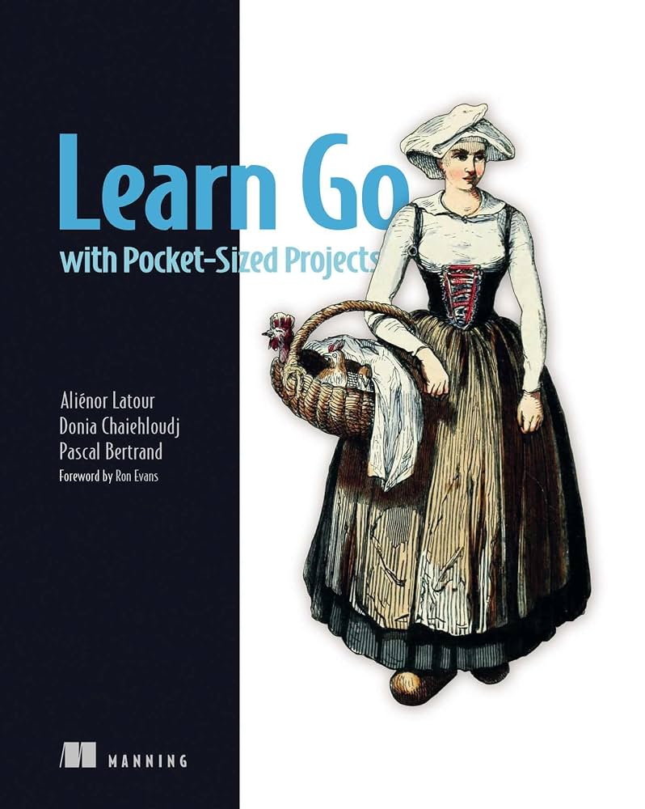

# Learn Go with Pocket-Sized Projects

This repository contains my work through *Learn Go with Pocket-Sized Projects*, a book by Aliénor Latour, Donia Chaiehloudj, and Pascal Bertrand, published by Manning Publications. The book teaches Go by building small, self-contained projects, such as games, CLI tools, and web services, that each introduce new language features and best practices. Each folder here corresponds to a chapter project, built and tested as I go.
